<p align="center">
  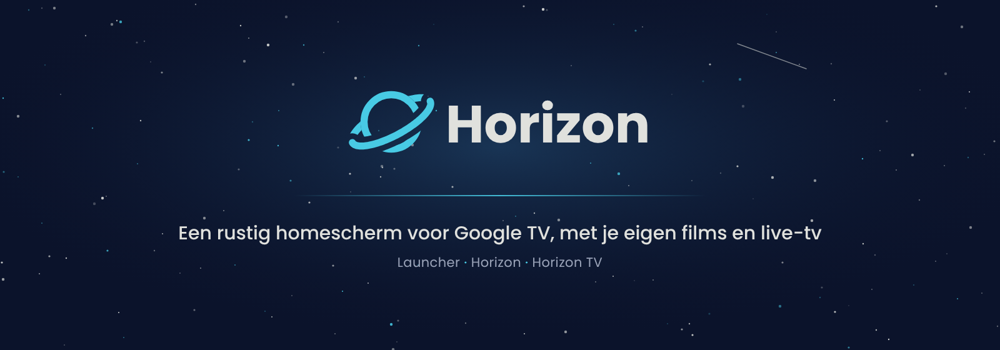
</p>

<p align="center">
  
  
  
  
  
</p>

<p align="center">
  <b>Een eigen homescherm voor de Chromecast met Google TV, zonder advertenties en zonder gedoe.</b><br>
  Met <b>Horizon</b> voor je films, <b>Horizon TV</b> voor live-tv met een echte tv-gids,<br>
  en <b>Roze Hoek</b> voor de 18+-zenders, in 90s-stijl en standaard uit.
</p>

<p align="center">
  <a href="#-wat-zit-erin">Wat zit erin</a> ·
  <a href="#-roze-hoek">Roze Hoek</a> ·
  <a href="#-aan-de-slag">Aan de slag</a> ·
  <a href="#-sleutels-en-privacy">Sleutels en privacy</a> ·
  <a href="#-techniek">Techniek</a> ·
  <a href="#-huisstijl">Huisstijl</a>
</p>

<br>

<p align="center">
  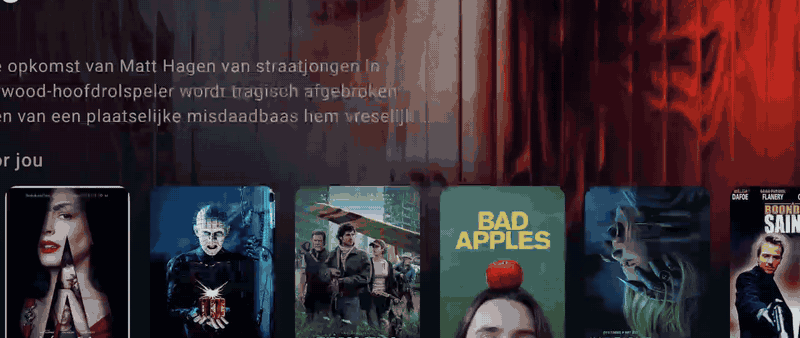
  <br>
  <sub>De startanimatie van Horizon, opgenomen op het kastje (ongeveer 3 seconden, elke toets slaat hem over).</sub>
</p>

---

## ✨ Wat zit erin

Eén app-pakket met vier tegels op je tv (Roze Hoek staat standaard uit). Alles is gebouwd met Kotlin en Jetpack Compose for TV, en volledig te bedienen met de afstandsbediening.

<table>
<tr>
<td width="50%" valign="top">

### 🏠 Thuis-launcher
Het homescherm zelf, in de stijl van Apple TV.

- **Top shelf** met een achtergrond in de merkkleur van de app of een filmbeeld van wat focus heeft.
- Rijen **Vastgezet**, **Aanbevolen voor jou** en **Alle apps**, die per rij scrollen.
- **Lang OK** op een app: vastzetten, verschuiven of app-info.
- **Filmaanbevelingen** van TMDB (trending, klassiekers en films die lijken op wat je leuk vindt), met scores van IMDb en Rotten Tomatoes via OMDb.
- Een filmscherm met trailer, "Vind ik leuk" en direct afspelen in Horizon.

</td>
<td width="50%" valign="top">

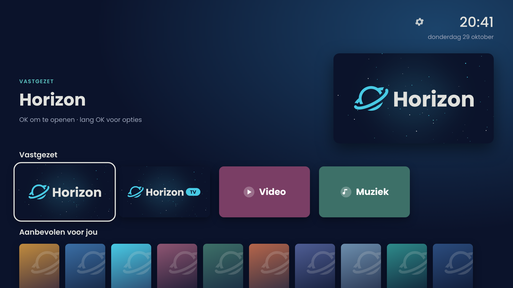

</td>
</tr>
<tr>
<td width="50%" valign="top">

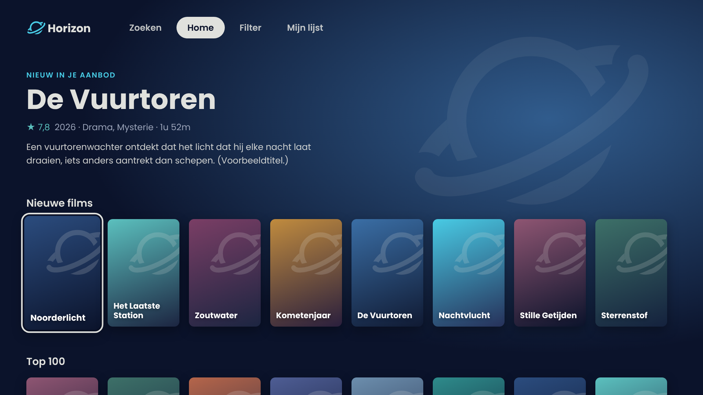

</td>
<td width="50%" valign="top">

### 🎬 Horizon
Je filmaanbod uit een Xtream-abonnement als nette streamingapp, ook bij tienduizenden films.

- **Nieuwe films** en een **Top 100** (best beoordeeld volgens TMDB, alleen wat in je aanbod zit).
- **Verder kijken**, **Mijn lijst** en 18 genrerijen, **gesorteerd op jouw kijkgedrag**.
- **Filter** op genres, periode en minimale score.
- Titels worden opgeschoond: geen landcodes, jaartallen of kwaliteitslabels in beeld.
- Een speler met spoelen dat steeds sneller gaat, ondertitels die worden onthouden, en terugval op Kodi.
- Na de eerste keer opent de catalogus in ongeveer 5 seconden.

</td>
</tr>
<tr>
<td width="50%" valign="top">

### 📺 Horizon TV
Live-tv met een tv-gids, gemaakt om snel te zappen.

- Opent **direct op de laatst bekeken zender**: de startanimatie speelt terwijl de zender al laadt.
- **Zappen in 0,9 tot 1,8 seconden**, met ▲▼, CH+/CH− of het zendernummer.
- **Zenderlijst** met categorieën, favorieten en wat er nu op is.
- **Tv-gids** van 2,5 uur, met **terugkijken** bij zenders die een archief hebben.
- Zuinig met je abonnement: bij doorzappen start een zender pas als je even stilstaat, en de stream stopt meteen als je de app verlaat.

</td>
<td width="50%" valign="top">

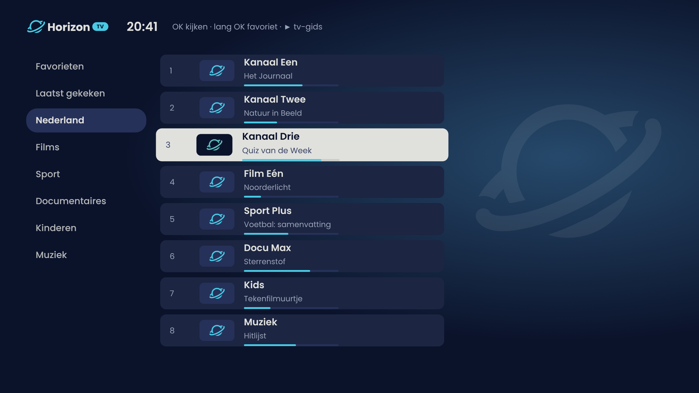

</td>
</tr>
<tr>
<td width="50%" valign="top">

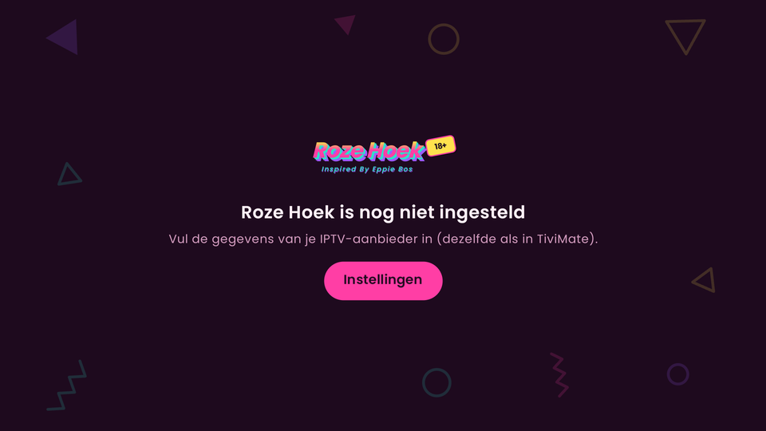

</td>
<td width="50%" valign="top">

### 💗 Roze Hoek
*Inspired By Eppie Bos.* Live-tv met **alleen de 18+-zenders** uit je aanbod, in een eigen 90s-stijl.

- **Standaard uit**: geen tegel en niet te starten. Aanzetten met de schakelaar bij *Instellingen → Apps*.
- Zelfde speler, zenderlijst en tv-gids als Horizon TV, maar met **eigen favorieten** en een eigen gids.
- Horizon TV laat deze zenders juist weg, dus ze lopen nooit door elkaar.
- Herkent volwassenen-zenders aan de vlag `is_adult` van de aanbieder of aan "XXX", "ADULT" of "18+" in de naam.

</td>
</tr>
</table>

<sub>De afbeeldingen van de launcher, Horizon en Horizon TV zijn schetsen in de echte huisstijl. Titels, zenders en programma's zijn verzonnen, zodat er geen beeldmateriaal van anderen in deze repository staat. Het beeld van Roze Hoek is een screenshot van de tv, zonder zenders.</sub>

<p align="center">
  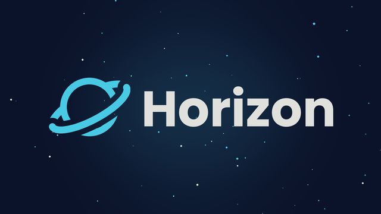
  &nbsp;
  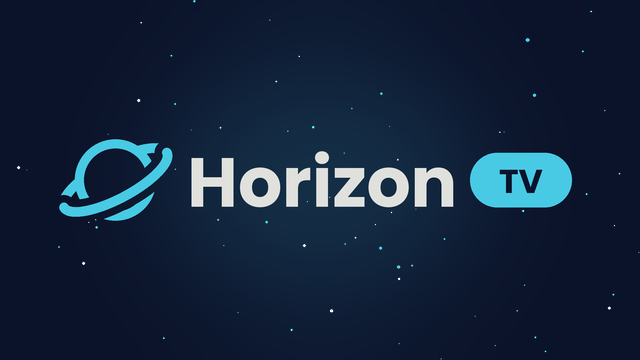
  &nbsp;
  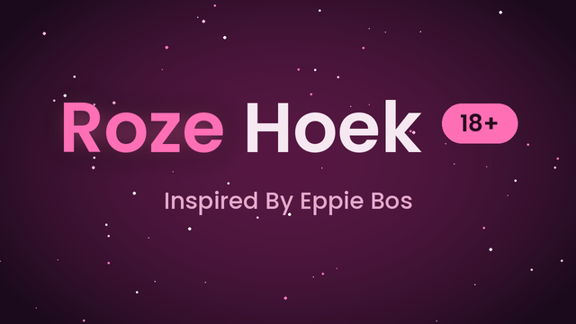
  <br>
  <sub>De tegels zoals ze op het homescherm staan.</sub>
</p>

---

## 💗 Roze Hoek

<p align="center">
  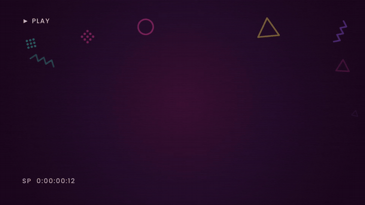
  <br>
  <sub>De startanimatie van Roze Hoek, opgenomen op het kastje.</sub>
</p>

Roze Hoek is een vierde app in hetzelfde pakket, voor de volwassenen-zenders uit je Xtream-aanbod. Hij staat **standaard uit**: zonder dat je hem aanzet is er geen tegel en kan hij ook niet gestart worden.

**Aanzetten:** tandwiel in de launcher (of *Instellingen* in Horizon TV) → **Apps** → *Roze Hoek* op **AAN**. De tegel verschijnt direct in de launcher, en de stand blijft bewaard na een update. Uitzetten gaat op dezelfde plek.

**90s-stijl**, in plaats van het blauw van Horizon:
- Hot pink, turquoise, citroengeel en paars op een donkere pruimkleur.
- Een woordmerk met schuine letters, een 3D-schaduw, een gele **18+**-sticker en de onderregel *Inspired By Eppie Bos*.
- Memphis-figuurtjes (krulletjes, driehoekjes, puntjes, zigzags) die bij het opstarten zweven en draaien.
- Een startanimatie als een videoband: *▶ PLAY*, een teller, een storingsstreep en beeldlijnen zoals op een oude beeldbuis-tv.

Horizon en Horizon TV houden hun eigen blauwe huisstijl; bij het wisselen springen de kleuren mee.

---

## 🚀 Aan de slag

### Wat je nodig hebt
- Een **Chromecast met Google TV** (of een ander Google TV- of Android TV-kastje met Android 9 of nieuwer; getest op Android 14).
- Een **Windows-pc** in hetzelfde wifi-netwerk. Android Studio is niet nodig.
- Optioneel: een gratis **TMDB**-token en **OMDb**-sleutel voor aanbevelingen en scores, en je **eigen Xtream-abonnement** voor Horizon en Horizon TV.

### Op de tv (eenmalig)
1. *Instellingen → Systeem → Over → Android TV OS-build*: klik er 7 keer op. Je bent nu ontwikkelaar.
2. *Instellingen → Systeem → Ontwikkelaarsopties*: zet **Draadloze foutopsporing** aan.

### Op de pc
Download de repository (groene knop **Code → Download ZIP**, of `git clone`) en dubbelklik de scripts op volgorde:

| Stap | Script | Wat het doet |
|:---:|---|---|
| 1 | `1-sleutels.cmd` | Vraagt je sleutels en IPTV-inlog en test ze direct. **Mag je overslaan**: alles kan ook later op de tv. |
| 2 | `2-bouwen.cmd` | Zet de eerste keer JDK 17, de Android SDK en Gradle neer in `tools-cache` (ongeveer 1,5 GB, niets systeembreed) en bouwt de APK. |
| 3 | `3-koppelen.cmd` | Koppelt de pc met de tv. Kies op de tv *Apparaat koppelen met koppelingscode* en neem het adres en de code over. |
| 4 | `4-installeren.cmd` | Installeert de app, compileert hem vooraf voor een snelle start en zet hem als homescherm. |

Je logboeken komen in de map `logs`. Gaat er iets mis, dan blijft het venster open met de foutmelding.

> [!TIP]
> De poort van draadloze foutopsporing verandert na een herstart van de tv. Lukt verbinden niet meer, verwijder dan `tv-adres.txt`. Het script vraagt dan het nieuwe adres.

> [!NOTE]
> Wil je terug naar het gewone Google TV-homescherm? Verwijder de app via *Instellingen → Apps*. Wil je de apps wel, maar niet als homescherm, installeer dan met `scripts\installeren.ps1 -NietAlsHomescherm`.

### Instellingen op de tv
Via het **tandwiel** in de launcher (of *Instellingen* in Horizon) vul je de TMDB-token, de OMDb-sleutel en je IPTV-inlog in, met een knop om ze te testen. Lange sleutels hoef je niet met de afstandsbediening te typen: open het adres dat op het scherm staat op je telefoon of pc, en voer de 4-cijferige code in. Dat werkt alleen zolang dat scherm open is.

---

## 🔒 Sleutels en privacy

- Er staan **geen sleutels, wachtwoorden of adressen** in deze repository. Ze staan op je pc in `launcher/local.properties` (zie [`local.properties.example`](launcher/local.properties.example)) of alleen op de tv. Beide gaan nooit mee naar git.
- Wat je via `1-sleutels.cmd` invult, wordt in de APK gebakken. **Deel je zelfgebouwde APK dus niet.** Wil je hem toch delen, laat de sleutels dan leeg en vul ze op de tv in.
- Je kijkprofiel (wat je kijkt en hoe lang) blijft **alleen op het kastje**. Het telt kijkminuten, Mijn lijst en wat je opent, en oud kijkgedrag telt na 30 dagen nog maar half.
- Stream-adressen en wachtwoorden komen nooit in het logboek.

---

## 🛠 Techniek

| | |
|---|---|
| **Taal en UI** | Kotlin 2.1, Jetpack Compose (BOM 2024.12) met `androidx.tv:tv-material` 1.0 |
| **Afspelen** | Media3 1.4 (ExoPlayer, HLS en MPEG-TS) |
| **Netwerk en beelden** | OkHttp 4.12, Coil 3 |
| **Bouwen** | AGP 8.7, Gradle 8.11, JDK 17, SDK 35, minSdk 28. Release-build met R8 en ProfileInstaller |
| **Data** | Xtream `player_api` en XMLTV, TMDB v3, OMDb |

### Snelheid (gemeten op een Chromecast met Google TV 4K)

| | Eerst | Nu |
|---|:---:|:---:|
| Koud starten van de launcher | 4,5 s | **0,5 s** |
| Haperende beelden tijdens scrollen | 100% | **2 tot 5%** |
| Zender wisselen in Horizon TV | n.v.t. | **0,9 tot 1,8 s** |
| Filmcatalogus openen (ongeveer 55.000 films) | n.v.t. | **5 tot 7 s** |

Wat het verschil maakte: een release-build met R8, vooraf compileren met `speed-profile`, minder vaak het scherm opnieuw opbouwen, verlopen die vooraf getekend worden in plaats van vervaging, en overgangen zonder extra tussenlaag.

### Projectstructuur

```
horizon-launcher/
├── 1-sleutels.cmd … 5-diagnose.cmd   startknoppen voor Windows
├── scripts/                          PowerShell: bouwen, koppelen, installeren, testen
├── launcher/app/src/main/java/nl/thuis/launcher/
│   ├── MainActivity.kt, AppRepository.kt   het homescherm
│   ├── ui/        top shelf, tegels, menu's, filmscherm, instellingen
│   ├── data/      TMDB en OMDb, aanbevelingen, sleutelopslag, instel-server
│   ├── bios/      Horizon: catalogus, kijkprofiel, genres, speler, huisstijl en logo
│   │              (RetroBrand.kt: de 90s-stijl van Roze Hoek)
│   └── tv/        Horizon TV en Roze Hoek: zenders, tv-gids (XMLTV), speler en afstandsbediening
├── launcher/app/src/test/            unit tests (titels, kijkprofiel, scores, zendernamen, gidstijden)
└── docs/                             afbeeldingen voor deze pagina
```

> In de code heet Horizon intern nog `bios`; de tegel en alles wat je ziet heet Horizon.

### Tests
De logica zonder Android, zoals het opschonen van titels, het kijkprofiel, de aanbevelingsscores en de tijden in de tv-gids, heeft unit tests:

```powershell
powershell -ExecutionPolicy Bypass -File scripts\build.ps1 -Task testReleaseUnitTest
```

Met `5-diagnose.cmd` voer je een testlijst uit op de tv zelf (toetsaanslagen, wachten op logregels, screenshots). Zie [`docs/examples/commands-voorbeeld.txt`](docs/examples/commands-voorbeeld.txt).

---

## 🎨 Huisstijl

**"Deep Space / Twilight"**: rustig donkerblauw, met hemelsblauw als enige echte kleur.

<p align="center">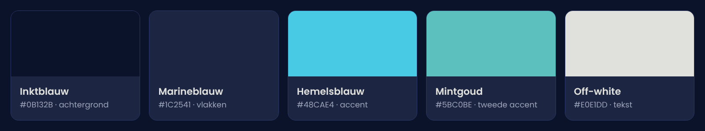</p>

- **Lettertype:** [Poppins](https://fonts.google.com/specimen/Poppins) (SIL Open Font License, zie [`licenses/`](licenses/Poppins-OFL.txt)).
- **Logo:** een planeet met een schuine ring, als vector getekend in [`HorizonBrand.kt`](launcher/app/src/main/java/nl/thuis/launcher/bios/HorizonBrand.kt). Elk onderdeel kan apart bewegen, zodat de startanimatie het logo stap voor stap opbouwt: sterren, een vallende ster, de planeet die zich tekent, de ring die op zijn plek kantelt met een maantje, letters die omhoog springen, en een horizonlijn die overloopt in de laadbalk.

---

## 🗺 Nog op de planning

- [ ] Series in Horizon (nu alleen films)
- [ ] Terugkijken verder dan de tv-gids reikt
- [ ] Zoeken op zender in Horizon TV
- [ ] Een "Nu live"-rij in de launcher
- [ ] De YouTube-knop op de afstandsbediening opvangen

---

## ⚖️ Disclaimer

Dit project levert **geen films, zenders of streams**. Horizon, Horizon TV en Roze Hoek zijn alleen een weergave voor een Xtream-abonnement dat je zelf afsluit. Gebruik ze alleen met een aanbod waarvoor je de rechten hebt.

Dit project is niet verbonden aan Google, TMDB, OMDb, IMDb of Rotten Tomatoes. Dit product gebruikt de TMDB API, maar wordt niet door TMDB ondersteund of gecertificeerd.

## 📄 Licentie

[MIT](LICENSE). Het lettertype Poppins valt onder de [SIL Open Font License 1.1](licenses/Poppins-OFL.txt).

<p align="center"><br>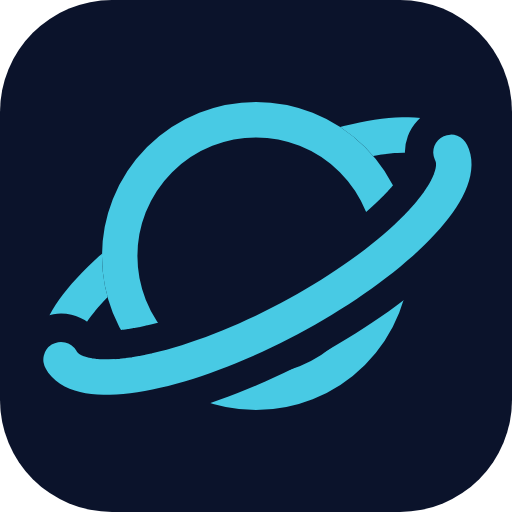</p>
